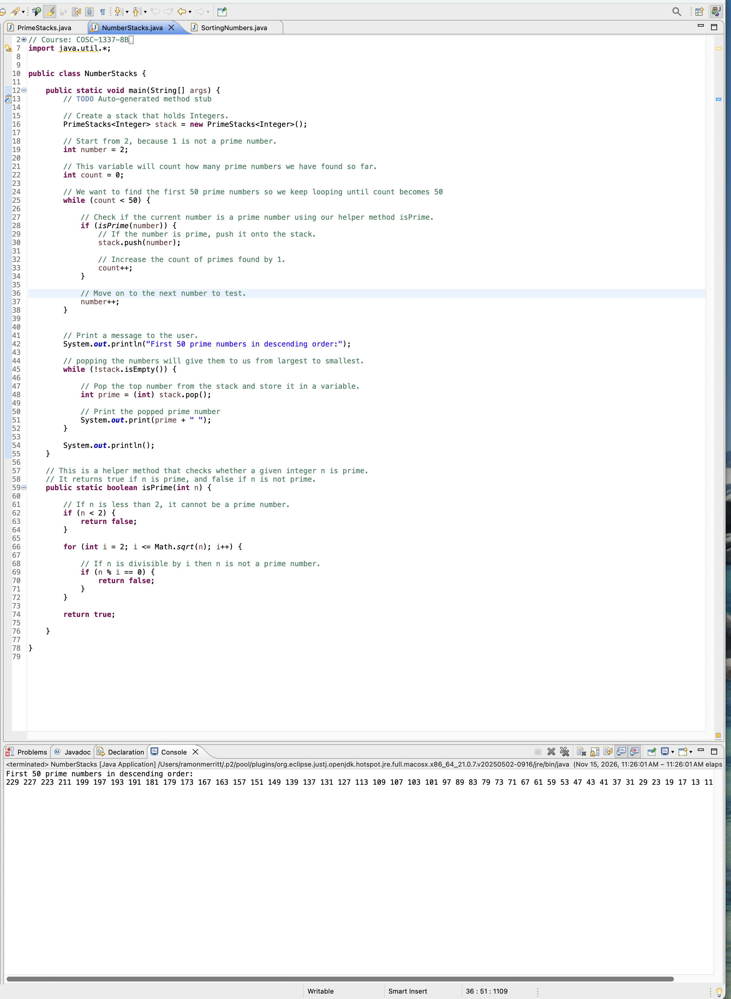
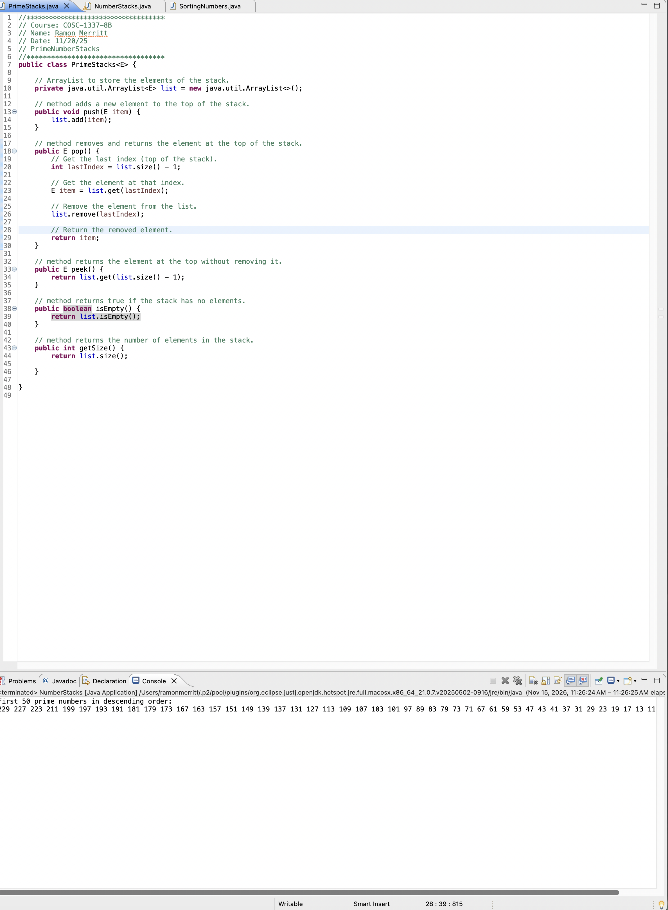
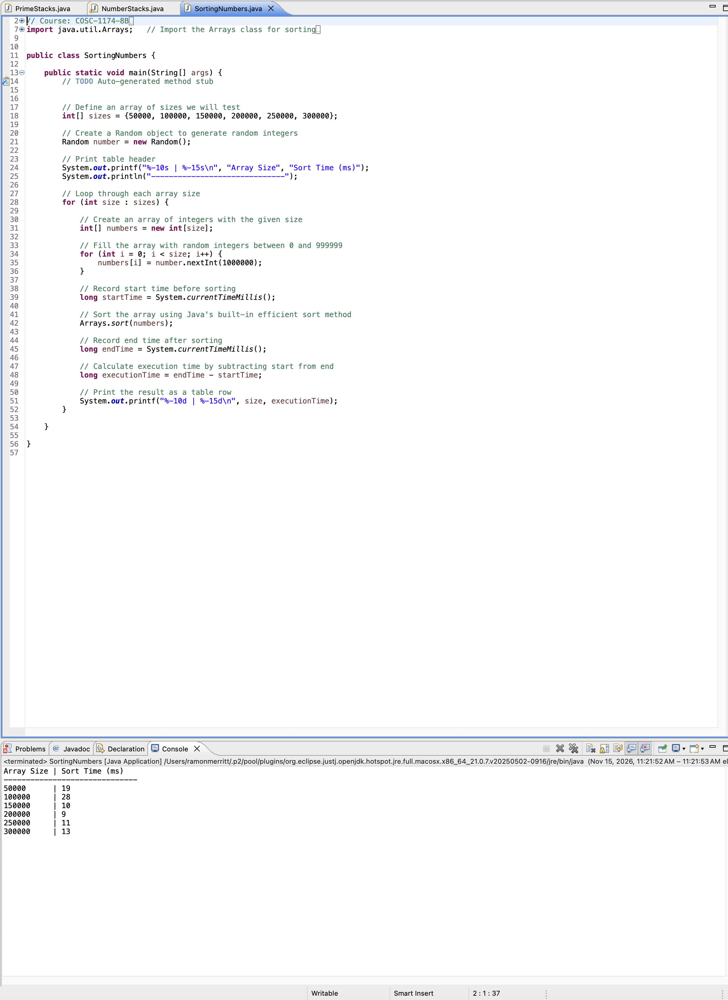

# Java Programming Coursework

## Project Overview

This collection contains Java programming assignments completed during my Computer Science studies at Lamar University.

These projects demonstrate my experience working with Java, data structures, algorithms, and problem-solving.

## Programs

## Java Prime Number Stack Project

This project identifies the first 50 prime numbers and stores them in a custom Java stack. The PrimeStacks class uses an ArrayList to implement stack operations such as push, pop, peek, isEmpty, and getSize. The NumberStacks program uses the stack to display the prime numbers in descending order.

### Programming Concepts
- Java generics
- Stack data structures (LIFO)
- ArrayList
- Loops and conditional statements
- Methods and object-oriented programming

### Screenshots

  

## Java Sorting Performance Project

This Java program measures how long it takes to sort arrays of different sizes. It generates random integers, uses Java's built-in Arrays.sort() method, and records the execution time in milliseconds.

The program tests arrays containing 50,000, 100,000, 150,000, 200,000, 250,000, and 300,000 integers.

### Programming Concepts
- Java arrays
- Sorting algorithms
- Random number generation
- Loops
- Execution time measurement

### Screenshot

  

## Technical Skills

- Java programming
- Data structures
- Algorithms
- Problem-solving
- Program organization

## Education

Lamar University
Computer Science
Expected Graduation: May 2029

## Author

Ramon A. Merritt
